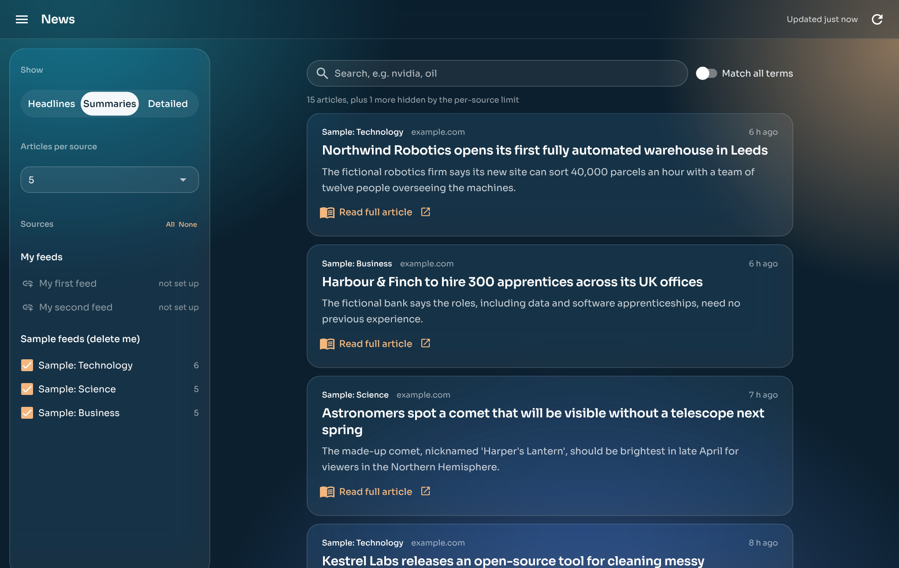
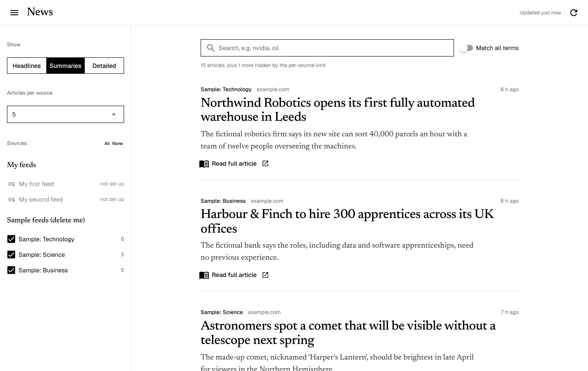
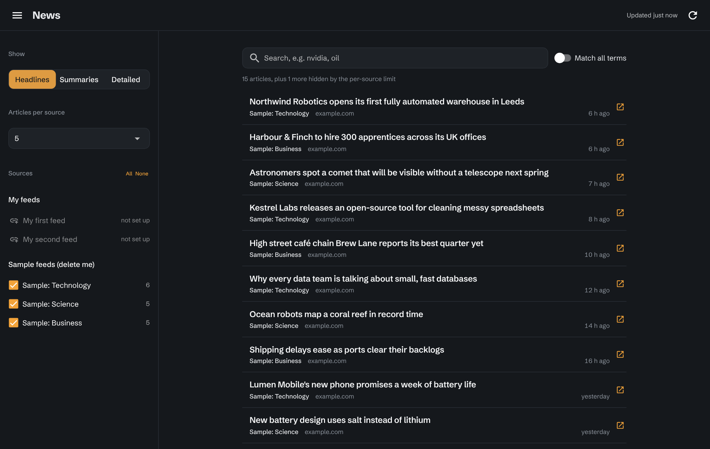
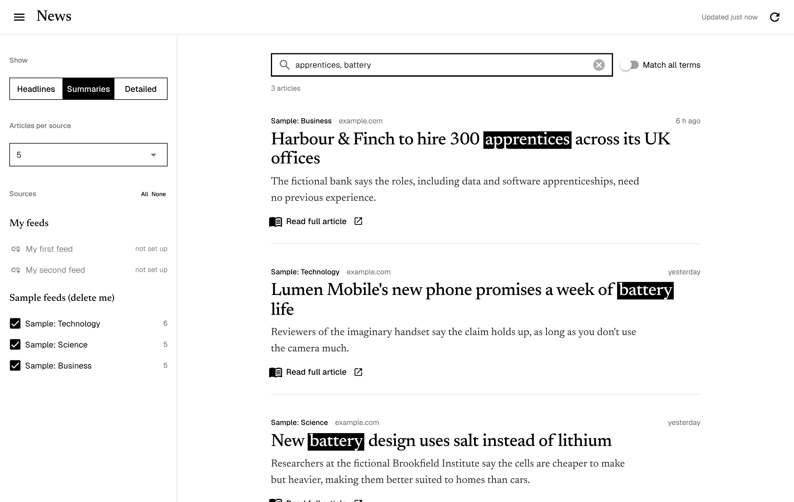

# Python News Reader

A calm, one-screen news reader. Add any RSS feeds, then filter, search and read full articles, all from one tidy page in your browser.



## About this project

I recently completed **Complete Python Mastery** by **Data With Baraa Academy**. I wanted to put what I'd learned into practice, so I teamed up with AI to build a program I'd actually use every day. This is what I created, and I really enjoy how it turned out.

It started as a short script that printed a few headlines in the terminal. Step by step it grew into a full app with a sidebar, live search, a reading panel and a choice of designs.

### How I built it

I built this with **Claude**, an AI assistant, as a learning project. My part was to:

- **Decide what the program should do** and how it should feel to use, then shape it through many rounds of testing and changes.
- **Set the coding rules** for every function: a clear, concise docstring; explicit types for every parameter and return value; names that say what things do; and comments explaining each step.
- **Run and test every version** with my own feeds, and report what broke or felt wrong.
- **Ask "why"** whenever something was new to me, so I understood the code rather than just copying it.

The AI wrote much of the code and explained each new idea along the way. The [What I learned](#what-i-learned) section lists the Python concepts the project uses and where to find them.

### How it grew

| Version | What it did |
|---|---|
| 1. Script | Parsed a dictionary of feeds and printed how many articles each had |
| 2. Questions | Asked which sources, search terms and details to show, checking every answer |
| 3. Modules | Split into folders that each do one job, each with its own README |
| 4. App | Replaced the questions with a sidebar, live search and a full-article reading panel (NiceGUI) |
| 5. Designs | Added four switchable themes, with fonts bundled so it works offline |

## Features

- **One screen, no questions.** Tick sources, pick a view and search; the list updates instantly.
- **Three views:** *Headlines* for skimming, *Summaries*, or *Detailed* with exact dates and links.
- **Live search** with highlighted matches. Separate terms with commas (`nvidia, oil`) to match *any* of them, or switch on *Match all terms*.
- **Read full articles** without leaving the app. Feeds often send only a snippet, so the app fetches the article from its website and shows just the text. Paywalled sites are explained clearly, with a link to the original.
- **Newest first**, with a set number per source, and repeated stories shown only once.
- **Google Alerts support.** Follow any topic, not just websites; the app cleans up Google's formatting and links automatically.
- **Four designs:** Ink, Frost, Signal and Classic.
- **Works on phones**, and can run as a website or a desktop window.

## Screenshots

| Ink: black and white | Signal: dark, headlines view |
|---|---|
|  |  |

Search highlights matches as you type:



*The screenshots use the included sample feeds, which are made-up stories.*

## Quick start

You'll need **Python 3.10 or newer**. These steps use [uv](https://docs.astral.sh/uv/); pip instructions follow.

```bash
git clone https://github.com/YOUR-USERNAME/python-news-reader.git
cd python-news-reader
uv sync          # installs everything
uv run main.py   # starts the app
```

Your browser opens at **http://localhost:8080**. Press **Ctrl+C** in the terminal to stop the app.

<details>
<summary>Using pip instead of uv</summary>

```bash
python -m venv .venv
source .venv/bin/activate        # Windows: .venv\Scripts\activate
pip install -r requirements.txt
python main.py
```
</details>

The first time you run it, you'll see three **sample feeds** of made-up stories, plus two sources marked **not set up**, waiting for your own feeds.

## Add your own feeds

Open **`settings/feeds.py`** and replace a placeholder with a real feed:

```python
FEED_GROUPS = {
    "My feeds": {
        "BBC News": "https://feeds.bbci.co.uk/news/rss.xml",   # was PLACEHOLDER_URL
        "My second feed": PLACEHOLDER_URL,                      # shows as "not set up" until filled in
    },
    ...
}
```

Each group becomes a heading in the sidebar. Restart the app to see the changes. When you're ready, delete the *Sample feeds* group.

**[docs/ADDING_FEEDS.md](docs/ADDING_FEEDS.md)** explains where to find feeds, including how to turn any Google search into a feed with Google Alerts.

## Choose a design

Set `THEME` in **`settings/app_settings.py`**:

| Theme | Look |
|---|---|
| `"ink"` | Black and white, with large serif headlines and lots of space |
| `"frost"` | Glassmorphism: frosted panels over a soft teal and amber background |
| `"signal"` | Dark graphite; articles from the last 3 hours carry an amber bar |
| `"classic"` | Standard Material Design blue |

To try one without changing anything, add `?theme=frost` (or `ink`, `signal`) to the address: `http://localhost:8080/?theme=frost`.

## Project structure

```
python-news-reader/
├── main.py               Starts the app
├── explore_feed_keys.py  Helper: lists everything a feed contains (run in the terminal)
├── settings/             Your feeds, the design, and how the app runs  → settings/README.md
├── feeds/                Downloading, cleaning, full-text fetching     → feeds/README.md
├── selection/            Gathering, de-duplicating, sorting, limiting  → selection/README.md
├── search/               Filtering by search terms                     → search/README.md
├── gui/                  Everything on screen, and the themes          → gui/README.md
├── sample_feeds/         Made-up stories so the app works straight away
└── docs/                 Guides and screenshots
```

Every folder has its own README explaining what's inside. Only `gui/` knows about the screen: `feeds/`, `selection/` and `search/` just take data in and hand data back, so each part can be understood, tested and fixed on its own.

### What happens when you click

```
tick a source / type a search / change a view
  └─ the choice is saved in ReaderState, and the list is redrawn
       └─ find_visible_entries (gui/app.py)
            ├─ collect_entries_from_sources   selection/
            ├─ remove_duplicate_entries       selection/
            ├─ filter_entries_by_search       search/
            ├─ sort_entries_newest_first      selection/
            └─ limit_entries_per_source       selection/
```

## What I learned

| Concept | Where to see it |
|---|---|
| Functions with type hints and docstrings | Every file, e.g. `search/search.py` |
| Dictionaries, lists, sets and loops | `selection/arrange.py`, `settings/feeds.py` |
| `enumerate`, `zip` and tuple unpacking | `feeds/fetch.py`, `gui/news_list.py` |
| Regular expressions (`re`) | Whole-word search in `search/search.py`; HTML cleaning in `feeds/clean.py` |
| Working with dates and times | `selection/arrange.py`, `gui/formatting.py` |
| Packages and imports across folders | The folder layout, and `__init__.py` files |
| Classes and dataclasses | `NewsStore` in `feeds/news_store.py`, `ReaderState`, `Theme` |
| Running work in parallel (threads) | Downloading feeds at the same time in `feeds/fetch.py` |
| `async` / `await` | Keeping the screen responsive while downloading, in `gui/app.py` |
| Event-driven GUIs | Buttons, checkboxes and timers in `gui/` |
| Caching results | `@lru_cache` in `feeds/full_text.py` |
| Separating logic from display | Only `gui/` touches the screen |

## Putting it online

Website mode is the default, so the same code can run on a hosting service and be available from any device:

1. Push this repository to GitHub.
2. Create a web service on a host that runs Python. Render's free tier is a common choice; free tiers change, so check what's currently offered.
3. Set the **build command** to `pip install -r requirements.txt` and the **start command** to `python main.py`.
4. The host's `PORT` is picked up automatically.

> **Keep personal feed URLs private.** Google Alerts links are tied to your account. Don't commit them to a public repository, and remember that anyone with your site's address can see the feeds it shows.

To run it as a desktop window instead, install the extra with `uv sync --extra desktop` and set `APP_MODE` to `"desktop"` in `settings/app_settings.py`.

## Built with

- [feedparser](https://github.com/kurtmckee/feedparser): reading RSS and Atom feeds
- [NiceGUI](https://nicegui.io): the interface, written in Python
- [trafilatura](https://github.com/adbar/trafilatura): pulling article text out of web pages
- [rich](https://github.com/Textualize/rich): coloured tables for the terminal helper
- Fonts: Newsreader, Geist, Sora and Schibsted Grotesk, all under the SIL Open Font License (licences in `gui/fonts/`)

## Licence

MIT, see [LICENSE](LICENSE).
